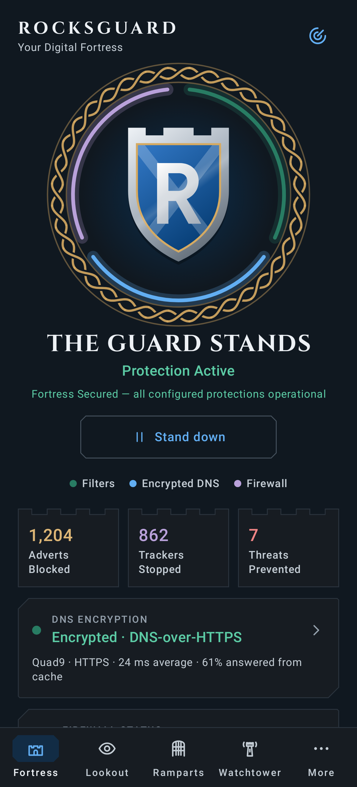
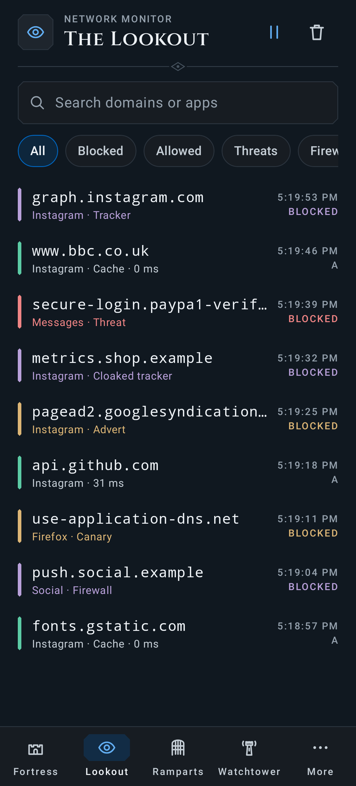
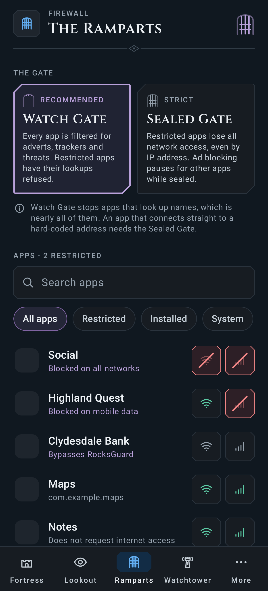
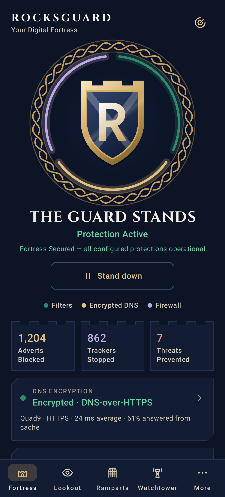
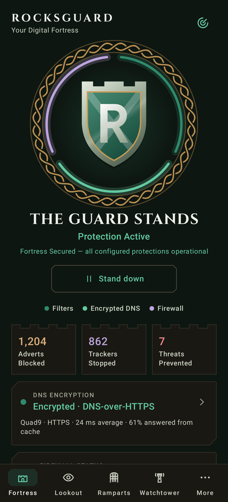
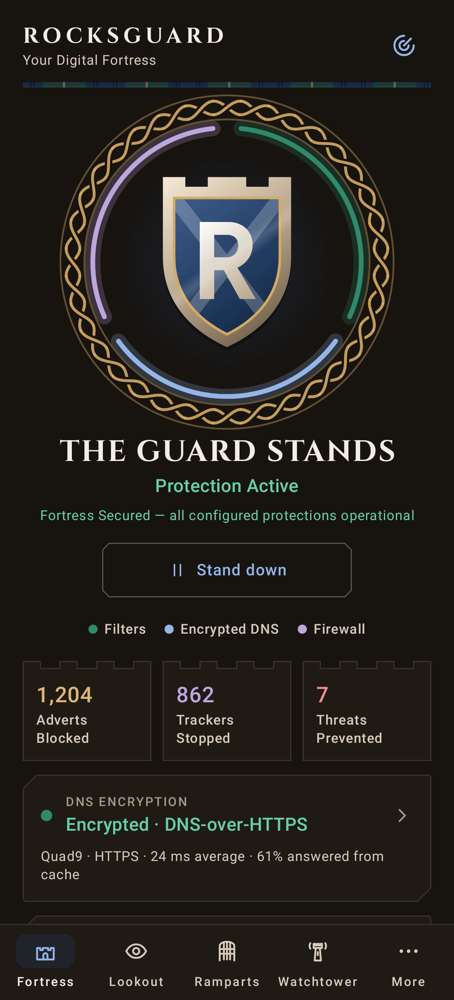
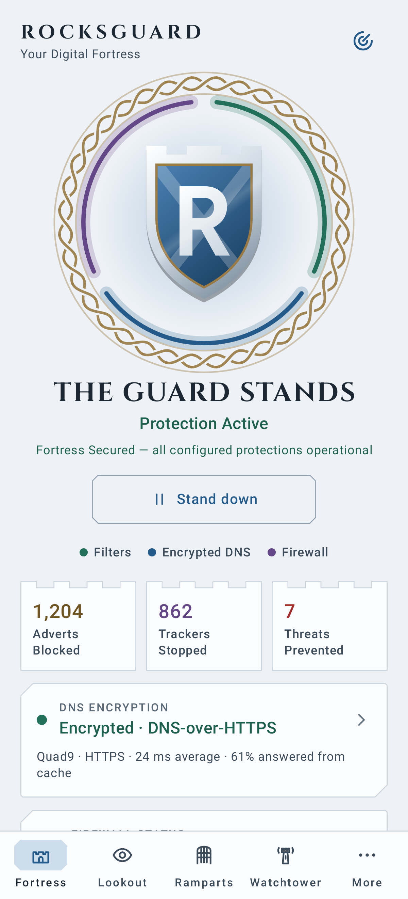

# ROCKSGUARD — The Scottish Guardian

**Forged in Scotland. Built for Privacy.**

RocksGuard is an Android privacy app that blocks adverts, trackers and malicious domains for every app on the device, encrypts DNS, and includes a per-app firewall. It runs entirely on the phone as a local VPN: no account, no adverts, no analytics, no subscription.

<p align="center">
  
  
  
</p>

## The Highland Shield design language

| Element | Inspiration | Where |
|---|---|---|
| Crenellated shield mark with engraved Saltire and stylised R | Highland stone fortresses, the Saltire | Launcher icon, splash, notifications, Fortress |
| Two-strand Celtic plait ring, drawn over/under procedurally | Celtic knotwork and engraved metalwork | Around the shield |
| Three illuminated system arcs | Beacons on the walls | Filters (green), Encrypted DNS (blue), Firewall (thistle) |
| Cut-corner "dressed stone" panels and battlement-topped counters | Granite masonry and curtain walls | Every screen |
| Cinzel display type (inscriptional capitals) | Carved lintels | Titles only; body text stays in the system face for legibility |
| Original RocksGuard tartan sett, woven in code | Traditional tartan | Scottish Heritage theme, About |
| Thistle, portcullis, watchtower, anvil icons | Scottish heraldry | Custom 24 dp icon set |

**Palette:** Highland Midnight `#101820`, Granite Black `#171C22`, Saltire Blue `#0065BD`, Thistle Purple `#8064A2`, Highland Green `#287C63`, Silver Mist `#C4CDD5`, Heather Gold `#D5AA62`, Warning Red `#C44545`.

**Seven themes**, each with light and dark variants (Fortress Black is dark-only, since AMOLED black only saves power in the dark): Highland Midnight, Royal Edinburgh, Thistle & Heather, Caledonian Forest, Highland Winter, Scottish Heritage, Fortress Black. You can also schedule dark hours, pick a separate night theme, and choose a custom accent. A unit test verifies every theme, and every custom accent, against WCAG AA contrast (normal text 4.5:1, primary text 7:1).

<p align="center">   </p>

## The fortress (navigation)

| Section | Function |
|---|---|
| **The Fortress** | Dashboard: animated shield, status, real counters, arrangeable widgets, one-tap protection, security scan |
| **The Lookout** | Live, searchable DNS activity with a plain-English reason for every block |
| **The Ramparts** | Per-app firewall (Wi‑Fi / mobile data), Watch Gate or Sealed Gate, VPN bypass for incompatible apps |
| **The Watchtower** | Encrypted resolver choice (HTTPS/TLS), live health, measured latency, fallback |
| **The Shield** | Category switches, CNAME uncloaking, block response, your own block/allow rules |
| **The Armoury** | Filter list subscriptions, updates, custom lists |
| **The Keep** | Fortress inspection (security checklist), privacy report, data controls |
| **The Workshop** | Themes, motion, behaviour, about |

Phones use a bottom bar with four sections plus a Gatehouse sheet for the rest. Screens 600 dp and wider use a navigation rail with every section, and the Fortress splits into two columns.

## How protection works

```
 app ──DNS──▶ [tun: virtual resolver 10.111.222.1] ──▶ GuardEngine
                                                        │ firewall rule? (uid via getConnectionOwnerUid)
                                                        │ user allow / block rules
                                                        │ list exceptions, list blocks (category on?)
                                                        ├─ blocked → answered on-device (0.0.0.0 / NXDOMAIN / REFUSED)
                                                        └─ allowed → TTL cache → DoH / DoT resolver
                                                                       └─ CNAME chain re-checked (uncloaking)
```

* **Watch Gate (default).** Only the virtual DNS address is routed into the tunnel, so other traffic never touches RocksGuard and there is no throughput cost. Firewall rules are enforced by refusing the app's lookups. This needs Android 10+ to identify the requesting app.
* **Sealed Gate.** Only firewalled apps are routed into the tunnel, and every packet they send is refused: TCP gets an immediate RST, so the app fails fast instead of hanging. This also stops apps that connect to hard-coded IP addresses. Android cannot route different apps differently within one VPN, so ad filtering pauses for other apps while the gate is sealed. The app says this plainly.
* **Safety invariant:** with no apps to seal, Android would treat an empty allow-list as "all apps" and black-hole the whole device. `TunnelPlanner` falls back to Watch Gate instead, and this is unit-tested.

### Security engineering

* **Encrypted DNS:** RFC 8484 DoH over HTTP/2 with connection reuse and ID 0 for cacheability, or RFC 7858 DoT with pooled connections. DoT verifies **both** the certificate and the hostname; a bare `SSLSocket` doesn't check the hostname, which is a common DoT bug.
* **No bootstrap leak:** resolver hostnames resolve from pinned anycast addresses, never a plaintext lookup.
* **Failover:** an ordered resolver pool with a circuit breaker (3 failures → skipped for 30 s) and EWMA latency. Plaintext fallback is **off** by default; when encrypted resolvers fail, RocksGuard fails closed.
* **CNAME uncloaking:** trackers disguised behind first-party names are caught by re-checking each CNAME target. This also applies to cached answers.
* **Bypass resistance:** the `use-application-dns.net` canary gets NXDOMAIN, so browsers don't silently switch to their own DoH. There's also an optional list of DoH/VPN/proxy bypass endpoints.
* **No cleartext anywhere:** the network security config forbids it; list downloads refuse https→http redirects, cap the size (40 MB), and are validated before they replace the previous good copy.
* **Hardened parsing:** every DNS and IP parser is bounds-checked and detects compression loops. A 20,000-iteration mutation fuzz test confirms malformed input can only raise the expected format error.
* **Private DNS conflict detection:** Android's strict Private DNS silently bypasses any VPN-based filter. RocksGuard detects it and tells you how to fix it.
* **Data minimisation:** the activity log lives in memory only (1,500 entries max). Counters are the only thing persisted, and they're excluded from cloud backup.

### Performance: light as Highland mist

* **Compact rule store:** domains are kept as sorted 64-bit hashes plus a 4-byte payload, about 12 bytes per domain. *Measured:* 300,000 domains → 3.4 MiB serialised, built in about 0.3 s, about 1.3 µs per full lookup on the JVM test host. A `HashSet<String>` of the same list would take an estimated 30 MB or more (not measured). Compiled rules are cached on disk and reload at start-up without re-parsing.
* **Zero idle cost:** the tunnel uses a blocking read, resolver threads time out when idle, and statistics are event-driven, so RocksGuard schedules no timers while the phone is quiet.
* **Animations** run only on state changes: activation, a blocked threat, or a scan. They read animated values only in the draw phase, so frames redraw without recomposing. The idle shield renders zero frames. Reduced motion follows Android's "remove animations" setting, and a **Lite effects** tier switches on automatically on entry-level devices (low-RAM flag, under 3 GB RAM, or fewer than 6 cores). Protection is identical on every tier.
* List updates use the platform JobScheduler (no WorkManager dependency): about daily, battery-not-low, Wi‑Fi only by default, with ETag/If-Modified-Since.
* `setMetered(false)` stops Android 10+ from marking every network as metered while the VPN is up.
* **Release APK: 1.5 MB** (R8 plus resource shrinking).

## Verification status

| What | How it was checked | Result |
|---|---|---|
| Packet parsing, checksums, TCP RST (IPv4 and IPv6) | JVM unit tests | ✅ |
| DNS parsing, blocked responses, CNAME extraction, TTL ageing, negative caching | JVM unit tests and fuzzing | ✅ |
| Filter formats and precedence (hosts / domains / Adblock, exceptions, wildcards) | JVM unit tests | ✅ |
| Full engine pipeline (block, forward, cache, uncloak, SERVFAIL, canary, firewall, Sealed Gate) | JVM tests through `GuardEngine` with raw packets | ✅ |
| DoH client wire format and failover | MockWebServer tests | ✅ |
| All 7 catalogue resolvers answer real DoH queries | Live test (`./gradlew :core:test -Procksguard.live=true`) | ✅ |
| All 13 downloadable filter list URLs reachable and in the expected format | Fetched during development | ✅ (URLhaus was dropped: its hosts feed is retired) |
| Theme contrast (WCAG AA), including custom accents | Unit test | ✅ |
| UI renders (all screens, all themes, tablet, 160% font) | Robolectric native-graphics screenshots in `docs/screenshots/` | ✅ |
| Android Lint | `./gradlew :app:lintDebug` | ✅ No issues |
| **VpnService on a real device or emulator** | **Not run.** The build environment had no emulator (no KVM). | ⚠️ Needs on-device testing |

The on-device paths are written against documented platform APIs but have **not** been exercised on hardware. These include tunnel establishment, `getConnectionOwnerUid` attribution, always-on/lockdown, the QS tile, boot restore and notifications. Before shipping, test them on at least one device each for Android 8, 10, 14 and 15, including one aggressive OEM (Xiaomi, Samsung or Huawei).

### Known limitations

* DNS over TCP to the virtual resolver is refused with RST. Responses larger than the MTU are truncated, so a client that then retries over TCP will fail. This is rare for normal app lookups.
* Watch Gate firewalling can't stop an app that connects to a hard-coded IP. Use the Sealed Gate for those.
* App attribution needs Android 10+. On Android 8–9 the Lookout shows "Unidentified" and only Sealed Gate rules apply.
* Hash collisions in the compact rule store are theoretically possible (around n / 2⁶⁴ per lookup).

## Building

Requirements: JDK 17+ and Android SDK 35.

```bash
./gradlew :core:test                    # engine tests (fast, pure JVM)
./gradlew :app:testDebugUnitTest        # screenshot tests → docs/screenshots/
./gradlew :app:lintDebug
./gradlew :app:assembleDebug            # app/build/outputs/apk/debug/
./gradlew :app:assembleRelease          # minified; sign before distributing
```

Modules: `core/` is pure Kotlin (engine, DNS, filters, resolvers, palettes) and has no Android dependency, so it's fast to test. `app/` contains the VpnService, data layer and Compose UI. Brand masters live in `branding/`.

## Credits and licences

Cinzel typeface by Natanael Gama, SIL Open Font License 1.1 (`branding/Cinzel-OFL.txt`). OkHttp, AndroidX and Jetpack Compose are Apache 2.0. Filter lists remain the work of their publishers, under the licences shown in the Armoury. The RocksGuard mark, tartan sett and icons are original to this project.
